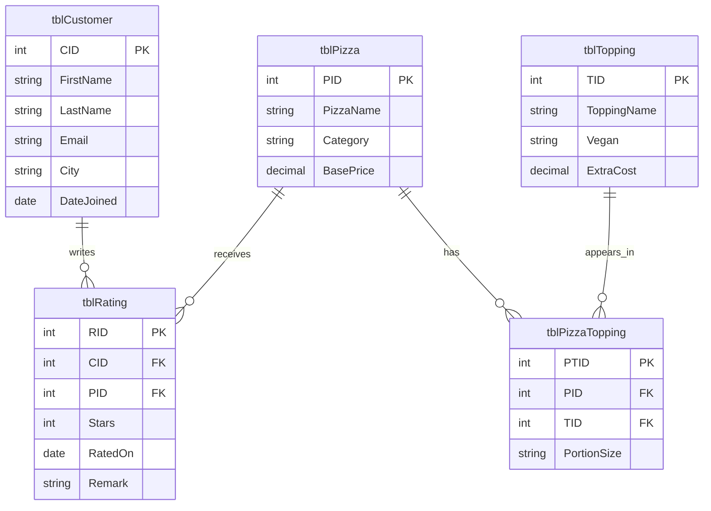

# SliceDB: Entity-Relationship Diagram
**Designed by:** Rishabh Bhutani

## My design decisions

- tblPizzaTopping exists because, It connects pizzas and toppings because one pizza can have many toppings, and one topping can appear on many pizzas

- PTID assigns a unique ID to each row. This makes it easy for the database to find information and run operations on them

- NULL means no value was provided, a customer can give stars without writing a comment

- Current topping field doesn't show that the meat is halal
Note: tblPizzaTopping exists because one pizza can have many toppings, and one topping can appear on many pizzas
